# CodePilot AI

**A local-first, AI-assisted developer platform — code, repositories, algorithms and learning in one workspace.**

[](https://github.com/rkslakshay/CodePilot-AI/actions/workflows/ci.yml)
[](LICENSE)


## 1. Introduction

CodePilot AI generates, converts, explains, runs and debugs code in **C, C++, Java, Python and JavaScript**, analyses whole repositories, creates UML diagrams from descriptions, code or repositories, visualises algorithms step by step, and teaches data structures and algorithms with quizzes and revision.

Everything runs on your own computer and costs nothing:

- no API keys, subscriptions or paid services — no cloud database, hosting or sign-in;
- source code never leaves the machine;
- local AI through [Ollama](https://ollama.com) is **optional**. Without it, deterministic offline engines (templates, a structured code translator, Tree-sitter static analysis, real algorithm tracers) do the work;
- every result says which engine produced it: **Local AI**, **Offline engine** or **Built-in template**. Offline output is never presented as AI.

## 2. Feature overview

| Area | Modules |
|---|---|
| **Code Intelligence** | AI Code Generator · Code Converter · Code Explainer · Compiler & Debugger |
| **Repository Intelligence** | Repository Analyzer (code review, bugs, security, complexity, dependencies, technical debt, Git change review, reports) |
| **Design Intelligence** | UML Studio (8 UML diagram types; generate from a description, source code or a repository; edit, validate, export) |
| **Algorithm Intelligence** | Algorithm Studio (26 algorithms, visual dry runs, pseudocode, flowcharts) |
| **Learning Intelligence** | Learning Hub (paths, lessons, viva, MCQ quizzes, practice, revision) |
| Workspace | Dashboard · My Workspace (projects & files) · History · Settings · command palette (Ctrl+K) |

## 3. Code Intelligence

| Module | What it does |
|---|---|
| **AI Code Generator** | Problem → program with explanation, variables, complexity, sample I/O, tests and edge cases. Local AI when configured; offline: 23 verified templates and 26 library algorithms, with an honest "no match" answer and a clearly-marked starter skeleton otherwise. |
| **Code Converter** | All 20 language pairs through a parse → IR → emit pipeline, including classes, constructors, methods, dictionaries / maps, sets, exceptions, string methods and slicing. Semantic comparison, warnings for anything that cannot be converted faithfully, and **Verify by running** (both programs are executed and their output compared — a conversion is only called verified after that). |
| **Code Explainer** | Summary, line-by-line explanations (beginner / advanced), functions, classes, loops, conditions, variables, data structures, concepts, Tree-sitter structural analysis and complexity with a confidence level and reasons. |
| **Compiler & Debugger** | Detects installed compilers, runs programs in a Windows sandbox with STDIN, explains compiler errors, detects common mistakes, proposes rule-based repairs as a diff, generates and runs test cases. |

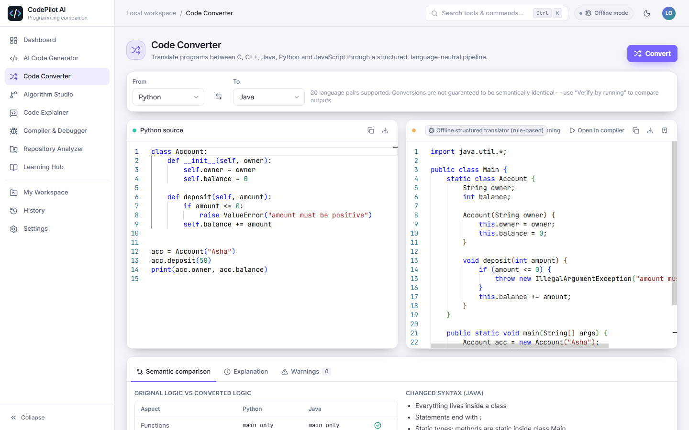

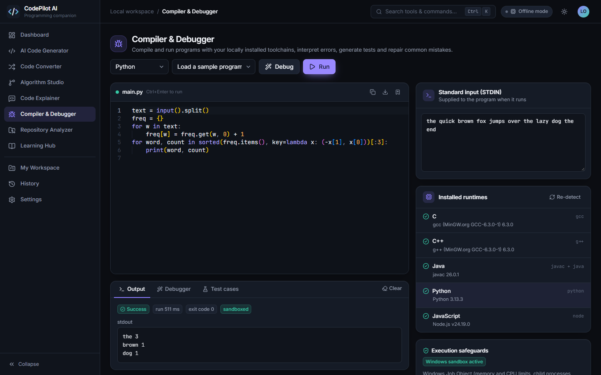

## 4. Repository Intelligence

Import a local folder or a ZIP archive (for example GitHub's *Download ZIP*) and get:

- an **overview dashboard** with real metrics and a reproducible quality score;
- a **file explorer** with findings marked in the editor;
- **static analysis — 47 rules** on Tree-sitter syntax trees plus security patterns (bugs, maintainability, performance, secrets, injection, unsafe execution, weak crypto, XSS, unsafe configuration, …), each with location, severity, confidence, why it matters and a suggested fix — see [docs/ANALYSIS_RULES.md](docs/ANALYSIS_RULES.md);
- **local AI code review** of a file, a function, a folder or the whole repository (chunked to fit the model, secrets redacted, cached, cancellable), plus questions about the code;
- **complexity**, **dependency** (npm, PyPI, Maven, Gradle, CMake — offline) and **technical-debt** analysis with evidence;
- **read-only Git**: branch, commits, staged / unstaged changes, diffs and a change review;
- **findings triage** (reviewed / fixed / false positive / notes / verified by me) that survives re-analysis;
- **reports** in Markdown and PDF.

| Overview | File explorer with findings |
|---|---|
| 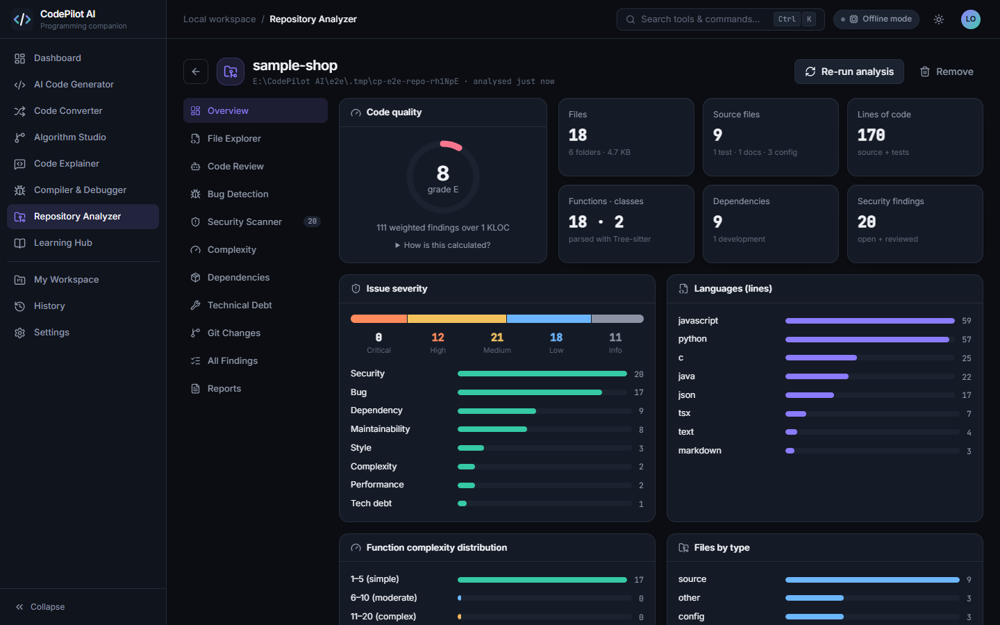 | 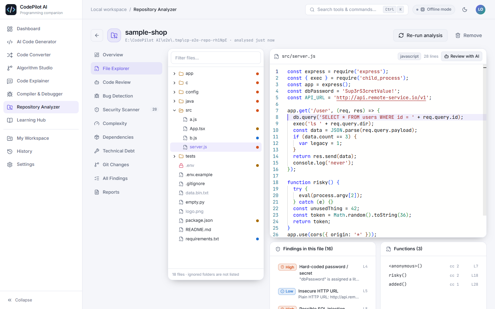 |
| **Security scanner & finding triage** | **Git change review** |
| 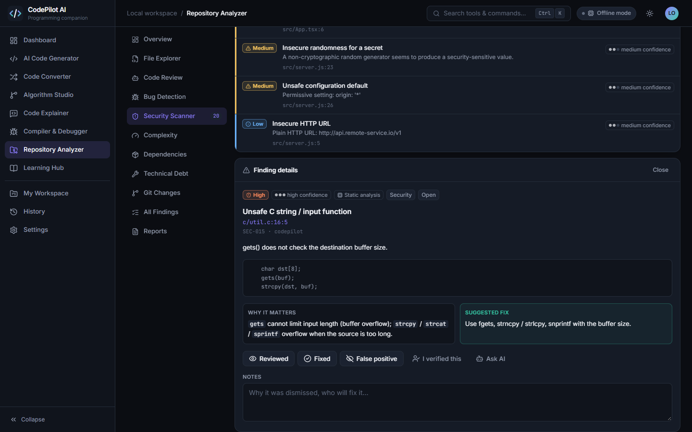 | 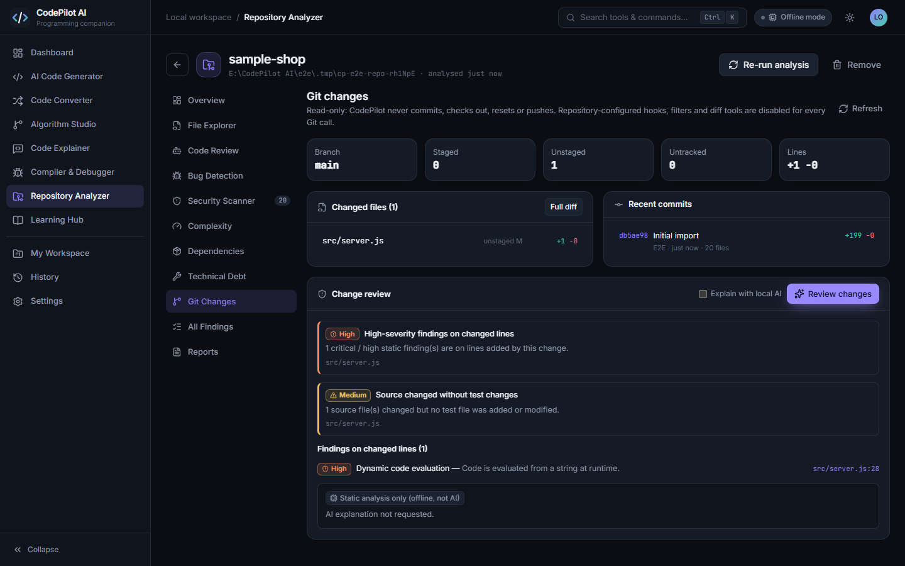 |
| **Complexity** | **Technical debt** |
| 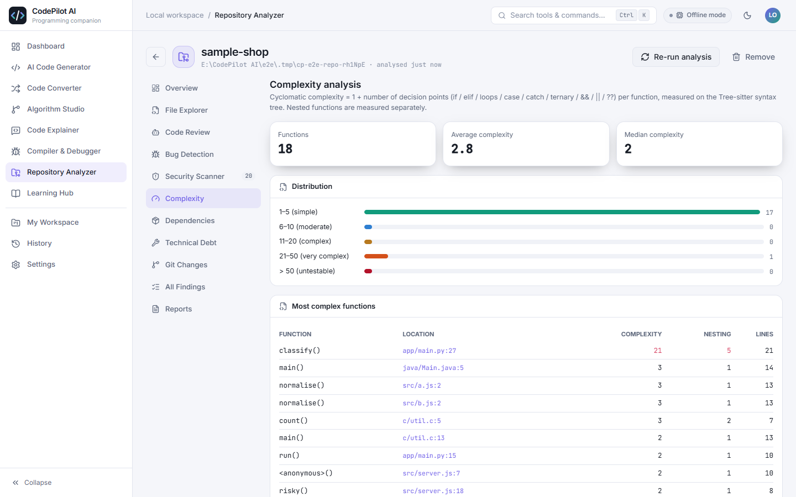 | 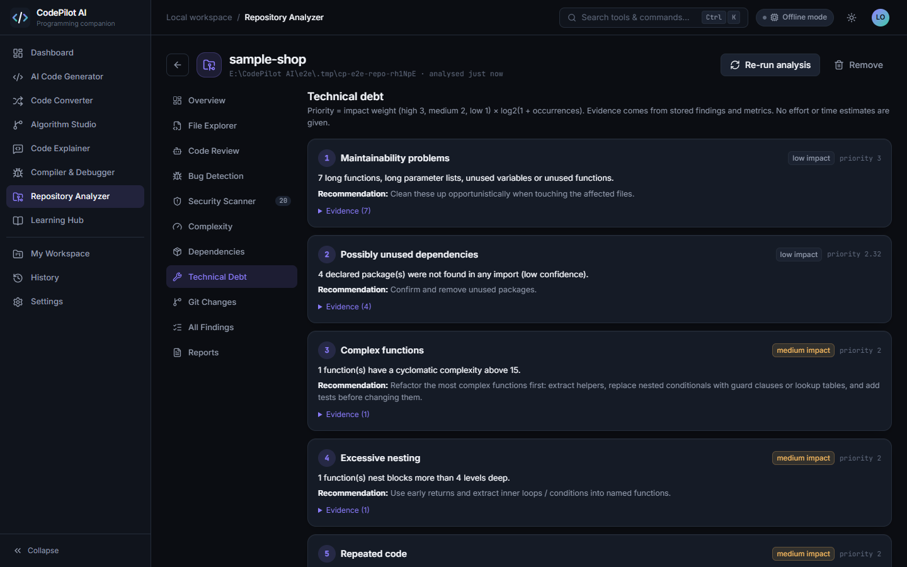 |

**Safety rules:** imported code is never executed; folders are read in place and never modified; ZIP archives are validated in full (no path traversal, absolute paths, links or encrypted entries; size and archive-bomb limits) before anything is unpacked; links are never followed; `.git`, `node_modules`, build output and `.gitignore`d files are skipped; `.env` files and keys are listed but never read, displayed, sent to the AI or put in reports; Git configuration that could run programs (hooks, filters, fsmonitor, external diff) is disabled for every Git call.

## 4a. UML Studio (Design Intelligence)

Professional UML diagrams — **class, use case, sequence, activity, state machine, component, deployment and object** — with real UML notation (visibility, abstract and static members, multiplicities, generalization / realization / aggregation / composition, «include» / «extend», activations and `alt / opt / loop` fragments, guards, fork / join and swimlanes, `event [guard] / effect`, provided / required interfaces, nested nodes and artifacts).

- **Generate** from a description (optional local AI; otherwise a deterministic offline generator that understands a PlantUML-like notation and plain sentences, labelled as not AI), from **source code** (Tree-sitter: class, sequence and activity diagrams for Java, Python, TypeScript, JavaScript, C++, C) or from an **imported repository** (classes, module dependencies, architecture, deployment — refused when the repository holds no evidence).
- **Edit** on a canvas with pan / zoom / grid, drag, connect, a properties inspector for every element, undo / redo, auto layout and live validation of UML rules. Evidence (file, line, extracted or inferred) is kept for generated elements.
- **Save** locally and **export** SVG, PNG, PDF, PlantUML and Mermaid (class / sequence / state).

| Editor | Sequence diagram (dark) |
|---|---|
| 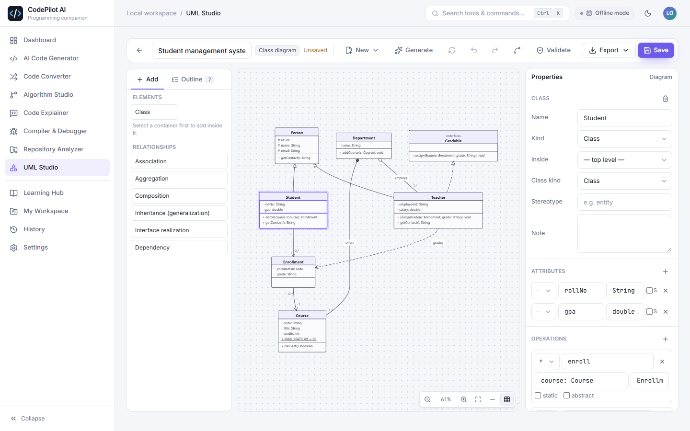 | 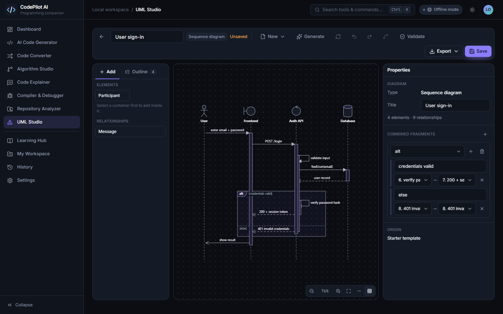 |

Full reference: [docs/UML_STUDIO.md](docs/UML_STUDIO.md).

## 5. Algorithm Intelligence

**Algorithm Studio** — 26 algorithms (searching, sorting, graphs, recursion, dynamic programming, data structures, tree traversals) with steps, pseudocode, Mermaid flowcharts (SVG / PNG export), code in five languages and a dry-run visualiser that really executes the algorithm on your input (play / pause / step / speed). It also turns your own problem statement or code into an algorithm, pseudocode and a flowchart.

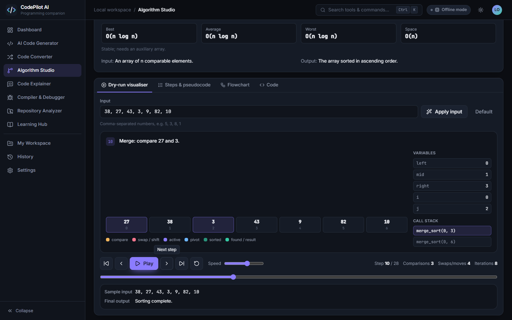

## 6. Learning Intelligence

**Learning Hub** — learning paths with progress, 11 DSA topics in 4 categories, lessons, viva questions, scored MCQ quizzes with an explanation for every wrong answer, a **revision mode** for questions you missed, practice problems by difficulty with hints and verified solutions, saved questions and completion tracking.

| Learning Hub | Dashboard |
|---|---|
| 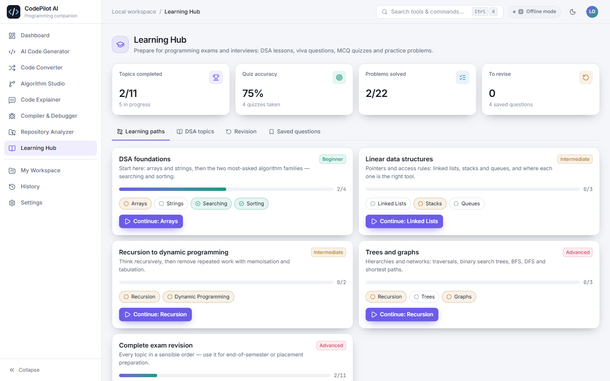 | 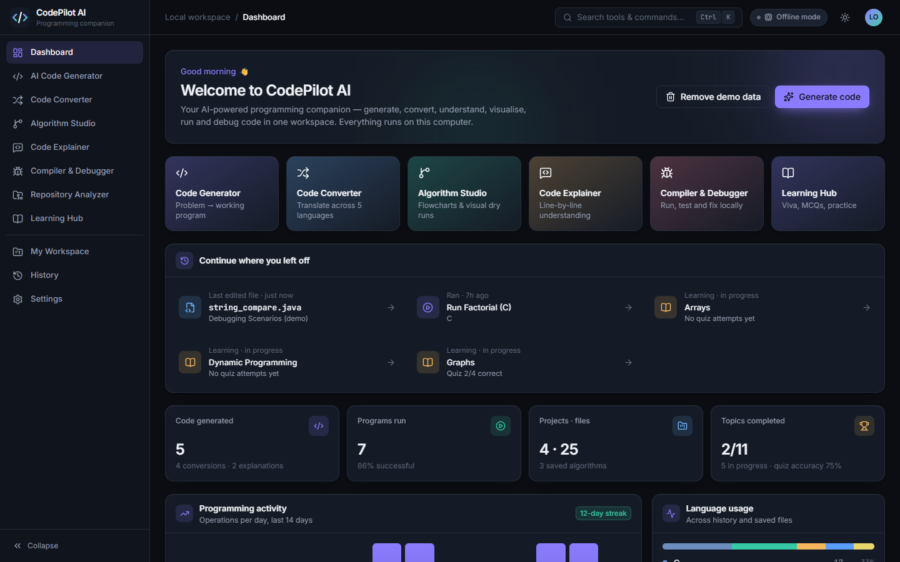 |

## 7. Technology stack

| Layer | Technology |
|---|---|
| Frontend | React 19, TypeScript, Vite 7, Tailwind CSS 4, React Router 7, Zustand, Monaco Editor (bundled locally), Mermaid, lucide-react |
| Backend | Node.js (≥ 22.13), Express 5, TypeScript (tsx), Zod |
| Database | SQLite via the built-in `node:sqlite` module, versioned migrations |
| Code analysis | Tree-sitter (`web-tree-sitter`, WebAssembly grammars for C, C++, Java, Python, JavaScript, TypeScript, TSX), custom parser / IR / emitters |
| Local AI | Ollama REST API with JSON-schema structured outputs (tested with `qwen2.5-coder:1.5b`) |
| Execution sandbox | Windows Job Object + low-integrity token (C# helper compiled with the .NET Framework compiler that ships with Windows) |
| Testing | Vitest, Supertest, React Testing Library, Playwright (installed Microsoft Edge) |

## 8. Architecture

```
Browser (React SPA) ──/api──▶ Express API (127.0.0.1 only) ──▶ SQLite (node:sqlite)
                                  │
                                  ├──▶ Offline engine: lexer → parser → IR → emitters / analyser / views
                                  ├──▶ Tree-sitter structural analysis
                                  ├──▶ Repository Analyzer: scan → rules → deps → git (read-only) → AI review → reports
                                  ├──▶ UML Studio: shared model / validation / layout / SVG renderer · NL (AI or rules) · Tree-sitter · repository evidence
                                  ├──▶ AI provider abstraction ──▶ Ollama (localhost, optional)
                                  └──▶ Executor ──▶ runner process ──▶ Windows sandbox ──▶ gcc / g++ / javac / python / node
```

The API only listens on `127.0.0.1`, rejects foreign `Origin` and `Host` headers (DNS-rebinding protection) and sends a strict Content-Security-Policy. Details, the data model and every design decision are in [ARCHITECTURE.md](ARCHITECTURE.md).

```
client/      React app (pages, components, Monaco, visualiser, Repository Analyzer UI, UML Studio)
shared/uml/  UML model, validation, editing operations, layout, SVG renderer, PlantUML / Mermaid export (server + client)
server/      Express API
  src/engine       parser, IR, type inference, emitters, analyser, Tree-sitter analysis, debugger
  src/repo         Repository Analyzer (zip, scan, detect, rules, deps, git, review, report, jobs)
  src/uml          UML Studio generation (AI + offline rules, source code, repository) and persistence
  src/execution    runtime detection, static guard, runner process, Windows sandbox (C#)
  src/providers    AI provider abstraction + Ollama client
  src/content      algorithm library, tracers, templates, learning content
  tests/           Vitest + Supertest, real-compiler integration tests, live Ollama tests
e2e/         Playwright journeys (throw-away database)
docs/        rule catalogue, UML Studio reference and screenshots
```

## 9. Screenshots

All screenshots above are in [`docs/screenshots/`](docs/screenshots). They were captured from the running app against a sample repository and clearly-flagged demo data; regenerate them with `CP_SHOTS=1 npx playwright test e2e/shots.spec.ts --project=desktop`.

## 10. Installation

Requirements:

- **Node.js 22.13 or newer** (tested with Node 24) — the database uses the built-in `node:sqlite` module;
- Git (optional, for the Repository Analyzer's Git section).

```bash
git clone https://github.com/rkslakshay/CodePilot-AI.git
```

```bash
cd CodePilot-AI
```

```bash
npm install
```

The SQLite database is created automatically at `server/data/codepilot.db` (excluded from Git).

## 11. Windows setup

CodePilot is developed and tested on Windows 11. Optional tools are detected automatically; missing ones are shown with installation guidance in **Compiler & Debugger → Installed runtimes**.

| Feature | Needs | Notes |
|---|---|---|
| Run C / C++ | GCC / G++ (MinGW-w64) on PATH | e.g. via MSYS2 |
| Run Java | JDK (`javac` + `java`) | free OpenJDK builds work |
| Run Python | Python 3 | detected via `python`, `py -3` or `python3` |
| Run JavaScript | Node.js | always available |
| Execution sandbox | .NET Framework C# compiler (part of Windows) | built automatically on first start |
| PDF reports | Microsoft Edge or Google Chrome | rendered locally; Markdown export always works |
| Git Changes | Git for Windows | all Git use is read-only |
| Extra Python checks | Ruff / Bandit (`pip install ruff bandit`) | optional |

## 12. Ollama setup (optional, free)

1. Install Ollama from https://ollama.com.
2. Download a model yourself — CodePilot never downloads models:

   | Model | Download | Memory | Notes |
   |---|---|---|---|
   | `qwen2.5-coder:1.5b` | ≈1 GB | ≈2 GB | fast on laptops; tested with CodePilot |
   | `qwen2.5-coder:3b` | ≈2 GB | ≈3.5 GB | better quality |
   | `qwen2.5-coder:7b` | ≈4.7 GB | ≈7 GB | best quality; needs 16 GB RAM |

   ```bash
   ollama pull qwen2.5-coder:1.5b
   ```
3. In **Settings → AI provider**, choose **Local AI (Ollama)**, pick the model and press **Test AI connection**.

Every AI answer must match a JSON schema and is validated; if Ollama is missing, stopped, slow or returns invalid output, CodePilot falls back to the offline engine and tells you why.

## 13. Running the application

```bash
npm run dev
```

Opens the API at `http://127.0.0.1:4317` and the app at **http://localhost:5173** (both with hot reload). For a single-port production build:

```bash
npm start
```

Then open **http://localhost:4317**. Code execution is **off by default** and is enabled only after you accept a safety notice. **Dashboard → Load demo data** adds clearly-flagged sample content that can be removed in one click.

## 14. Running tests

Latest results on the 3.1 release candidate (Windows 11, Node 24, from a clean clone; details in [TEST_REPORT.md](TEST_REPORT.md)):

| Suite | Result |
|---|---|
| Type checks (server + client) | 0 errors |
| Server tests (Vitest + Supertest, excluding live AI) | 312 / 312 passed |
| Client tests | 15 / 15 passed |
| Playwright E2E in Microsoft Edge | 67 passed (2 on-demand screenshot generators skipped) |
| Live local AI (`qwen2.5-coder:1.5b`) | 7 / 8 in the last run; the repository-review case is flaky because the small model sometimes returns malformed JSON (the app then falls back to labelled offline results) |

```bash
npm test
```

Runs the server suite (Vitest + Supertest, including tests that compile and run generated programs with the real compilers) and the client suite (React Testing Library). It takes several minutes.

```bash
npm run e2e
```

Builds the client and runs the Playwright journeys in the installed Microsoft Edge against a throw-away database (your data is never touched).

```bash
npm run typecheck
```

With Ollama running, `npx vitest run tests/ollama-live.test.ts` (inside `server/`) exercises the real model; it skips itself when Ollama is not available. The GitHub Actions workflow in [`.github/workflows/ci.yml`](.github/workflows/ci.yml) runs type checks, server and client tests, the production build and the E2E suite on a free Windows runner, without any AI model. Latest local results are in [TEST_REPORT.md](TEST_REPORT.md).

## 15. Security limitations

- **Code execution sandbox (Windows):** programs run in a Job Object (memory / CPU limits, no child processes) with a low-integrity token, so they cannot write your files or read CodePilot's data. They **can** still read ordinary files your account can read, and **network access is not blocked** by the operating system. It is not a virtual machine — only run code you trust. Elsewhere, programs run in a guarded process without OS isolation.
- **Static analysis cannot prove that code is correct or secure.** Pattern rules can miss vulnerabilities and report false positives; every finding shows its confidence.
- **No dependency vulnerability database** is consulted — dependency analysis is fully offline.
- The API is meant for the local machine only; do not expose port 4317 to a network.

## 16. Current limitations

- The offline converter handles procedural code plus classes, maps, sets and exceptions; inheritance, generics, lambdas and file I/O are left as marked comments with warnings.
- Complexity is a static estimate with a confidence level; "unknown" is a valid answer.
- Small local models are slow (≈30–60 s per review chunk for 1.5B) and can be wrong; AI findings stay low-confidence until you verify them.
- UML Studio: small local models produce valid but sometimes incomplete diagrams; the offline generator only understands documented patterns; edge bend points cannot be edited; Mermaid export covers class / sequence / state only (see [docs/UML_STUDIO.md](docs/UML_STUDIO.md#12-limitations)).
- Semgrep and ESLint are detected but not run (they would download rules from the internet or execute project configuration).
- Developed and tested on Windows; other platforms run without the OS sandbox and are not regularly tested.

See [PROJECT_STATUS.md](PROJECT_STATUS.md) for the full list.

## 17. Future roadmap

- **GitHub integration** (planned in [ARCHITECTURE.md](ARCHITECTURE.md)): public-repository import, OAuth device flow, pull-request analysis and previewed review comments — local-only, no cloud backend.
- Converter: inheritance and generics.
- Optional, consent-based dependency vulnerability lookup.
- Firewall-based network blocking for sandboxed programs.
- More visualisers (topological sort, union-find, DP tables).

## Documentation

[ARCHITECTURE.md](ARCHITECTURE.md) · [FEATURE_TRACKER.md](FEATURE_TRACKER.md) · [PROJECT_STATUS.md](PROJECT_STATUS.md) · [TEST_REPORT.md](TEST_REPORT.md) · [CHANGELOG.md](CHANGELOG.md) · [docs/ANALYSIS_RULES.md](docs/ANALYSIS_RULES.md) · [docs/UML_STUDIO.md](docs/UML_STUDIO.md)

## License

[MIT](LICENSE) © 2026 rkslakshay
