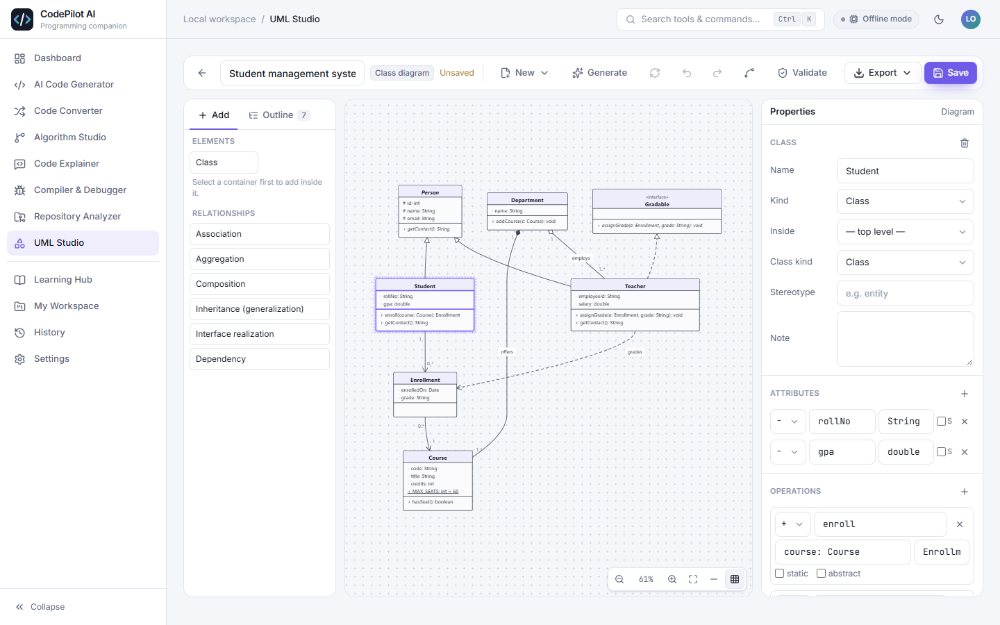
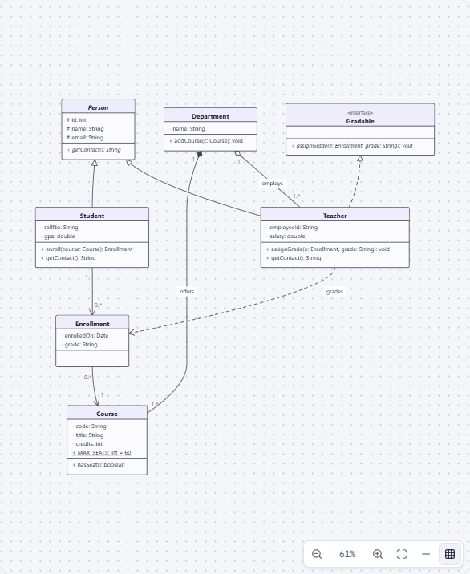
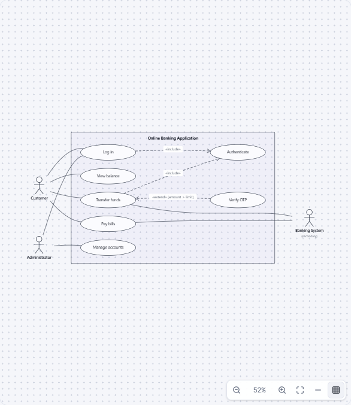
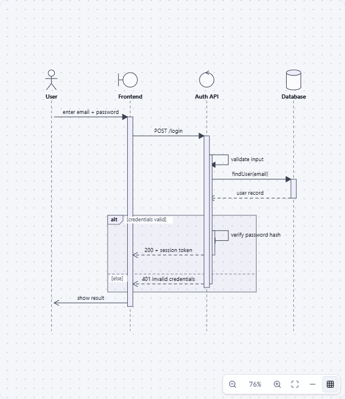
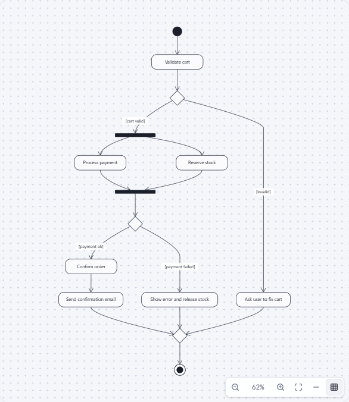
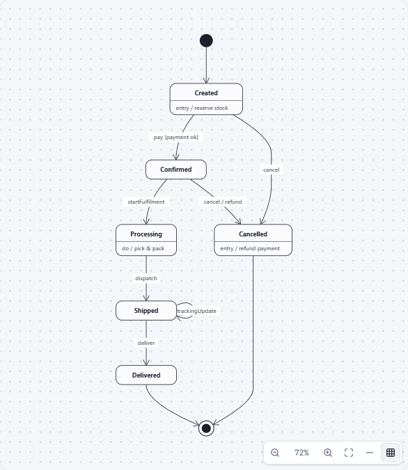
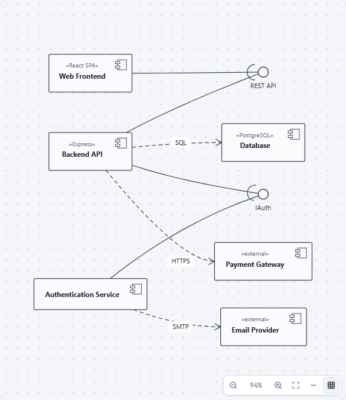
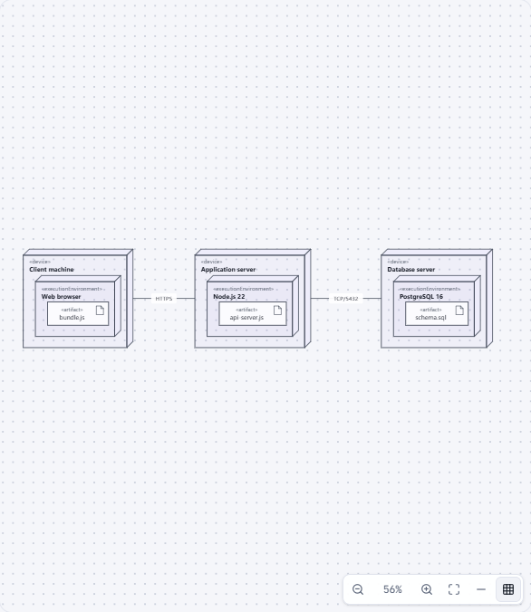
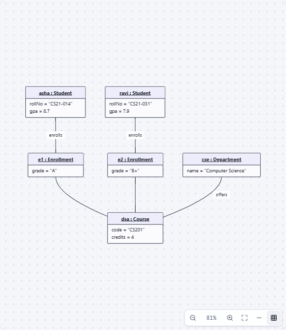

# UML Studio — reference

UML Studio is the CodePilot AI module for creating, generating, editing, validating, saving and exporting UML diagrams. Everything runs on your computer: generation, parsing, editing, rendering, storage and exports work **without** Ollama and without any network access. Local AI (Ollama) is optional and is always labelled when it was used.

Open it from the sidebar (**UML Studio**), the Dashboard tile, a file in **My Workspace** (toolbar **UML** or the file menu → *UML diagram*), or a repository in the **Repository Analyzer** (*Quick actions → UML diagrams*).



## Contents

1. [Diagram types and notation](#1-diagram-types-and-notation)
2. [Generation modes](#2-generation-modes)
3. [Editing](#3-editing)
4. [Validation](#4-validation)
5. [Saving](#5-saving)
6. [Export](#6-export)
7. [Offline behaviour and honesty rules](#7-offline-behaviour-and-honesty-rules)
8. [Architecture and rendering](#8-architecture-and-rendering)
9. [Structured model](#9-structured-model)
10. [API](#10-api-apiuml)
11. [Testing](#11-testing)
12. [Limitations](#12-limitations)

## 1. Diagram types and notation

| Type | Elements | Relationships | Notation drawn |
|---|---|---|---|
| **Class** | class, abstract class, interface, enumeration | association, aggregation, composition, inheritance, realization, dependency | three compartments; visibility `+ - # ~`; *italic* abstract classes / operations; <u>underlined</u> static members; «interface» / «enumeration» / custom stereotypes; hollow triangle (generalization), dashed hollow triangle (realization), filled / hollow diamond, open arrow for navigable association and dependency; multiplicities and role names at both ends |
| **Use case** | actor (primary / secondary), use case, system boundary | association, «include», «extend» (with condition), generalization | stick-figure actors (primary on the left, secondary on the right), ellipses inside a labelled boundary, dashed «include» / «extend» arrows |
| **Sequence** | participant, actor, boundary, control, entity, database | message: synchronous, asynchronous, return, create | lifelines, activation bars derived from call / return nesting, filled arrow (sync), open arrow (async), dashed open arrow (return), «create», self-calls; combined fragments `alt / opt / loop / par / break / critical` with guards and operand dividers |
| **Activity** | initial, final, flow final, action, decision, merge, fork, join, swimlane | control flow with guard | rounded actions, diamonds, solid fork / join bars, `[guard]` labels, swimlanes as columns |
| **State machine** | initial, final, state (with `entry / do / exit`), composite state, choice (decision) | transition `event [guard] / effect` | rounded states with an internal-activity compartment, nested composite states, self-transitions |
| **Component** | component, interface, port, node | provided interface (lollipop), required interface (socket), dependency, association | «component» icon, ball-and-socket interfaces, dashed dependencies, components nested in components or nodes |
| **Deployment** | node, device, execution environment, artifact, component | communication path (with protocol), «deploy», dependency | 3-D node boxes with «device» / «executionEnvironment» stereotypes, nesting, «artifact» with document icon |
| **Object** | object (`name : Class`) with attribute values | link (roles, multiplicities) | underlined `name : Class` header and a slot compartment `attribute = value` |

Every type opens from an example ("Example") or empty ("Blank") on the UML Studio home page. Screenshots of each example are in [`docs/screenshots/uml/`](screenshots/uml).

| Class | Use case | Sequence | Activity |
|---|---|---|---|
|  |  |  |  |
| **State machine** | **Component** | **Deployment** | **Object** |
|  |  |  |  |

## 2. Generation modes

**Generate** (home page or editor toolbar) offers three sources. Every result opens in the editor as an unsaved draft and shows which engine produced it.

### 2.1 Natural language

Choose the diagram type and describe the system. *Use an example* fills in a sample for the chosen type.

- **Local AI (optional).** When *Use local AI when available* is on and Ollama is reachable with the configured model, the model answers a strict JSON contract per diagram type (names, not ids). The answer is validated with Zod; malformed JSON gets one repair retry. References to names the model did not define are sent back for **one** bounded semantic-repair round; anything still unresolved is dropped and **listed as a warning** — never silently invented. Secrets in the description are redacted before the prompt is built. The result is labelled **Local AI · <model>** and every element carries evidence `basis: ai`.
- **Offline rule-based generator (not AI).** Used when AI is off, unavailable or fails. It understands:
  - a **PlantUML-like structured notation**, for example `Customer "1" --> "0..*" Order : places`, `Car --|> Vehicle`, `Order *-- "1..*" OrderItem`, `class A { +x: int; +m(a: T): R }`, `User -> API : login()`, `alt valid … else … end`, `[*] --> Draft`, `Draft --> Published : approve`, `asha : Student { gpa = 8.7 }`, `Frontend -( API`;
  - **plain sentences** per type: "A member can borrow multiple books", "A Car is a Vehicle", "X consists of Y", "Customer can view balance and pay bills", "Transfer funds includes Authenticate", "Verify OTP extends Transfer funds when …", "The Frontend sends the credentials to the Auth API", "If the cart is valid, … otherwise …", "In parallel …", "from Created to Confirmed when payment succeeds", "The API runs on the Application Server", "asha is a Student with gpa = 8.7".
  - Elements that are only implied (for example a plain list of states turned into a linear lifecycle) are marked **inferred**, and the assumption is listed in the warnings.
  - If nothing usable is recognised the request is refused (HTTP 422) with suggestions — no placeholder diagram is fabricated.

### 2.2 Source code

Parsed locally with Tree-sitter; imported code is **never executed**. Sources: pasted code, files from **My Workspace**, or files of an imported repository. Languages: Java, Python, TypeScript / TSX, JavaScript, C++, C.

| Diagram | What is extracted |
|---|---|
| Class | classes, interfaces, abstract classes, enums, structs; fields and methods with visibility (declared, or Python `_` / `__` conventions), static and abstract flags, parameter and return types; supertypes (generic arguments are not mistaken for supertypes); associations from field types with multiplicity (`List<T>` → `0..*`, optional → `0..1`); composition when the field is created in the constructor (**inferred**); dependencies from method signatures (**extracted**) or `new` expressions (**inferred**); external supertypes as «external» classes. Up to 60 classes. |
| Sequence | the calls made by one chosen function / method, in order, with `opt` / `alt` / `loop` fragments for `if` / `else` / loops. Only calls whose receiver type is declared in the analysed files are shown. |
| Activity | the control flow of one function: statements, `if / elif / else` decisions with guards and merges, loops, `return` / `throw`, `try`. |

Each element and relationship stores its **evidence**: file, line, and whether it was extracted directly or inferred.

### 2.3 Repository

Uses the files of a repository imported in the Repository Analyzer (read-only).

| Diagram | Evidence used | When there is not enough evidence |
|---|---|---|
| Class diagram of the code | Tree-sitter extraction of up to 400 source files (optionally one folder) | refused when no classes exist |
| Modules (component) | folders at a chosen depth (≤ 18 modules) and resolved `import` / `require` / `#include` statements; external libraries only when declared in a manifest (top 10) | refused when no internal imports exist |
| Architecture (component) | detected frameworks, database drivers and service SDKs from manifests | refused (`not_enough_evidence`) |
| Deployment | `docker-compose` services (images, ports, `depends_on`), Dockerfiles (`FROM`, `EXPOSE`, `CMD`); otherwise front-end / back-end frameworks and database drivers with **generic, low-confidence hosting** and an explicit warning | refused — *"A deployment diagram would have to be invented, so none was generated."* |

Saved diagrams generated from a repository are linked to it (`/uml?repoId=…` lists them).

## 3. Editing

- **Canvas:** drag the background to pan, mouse wheel to zoom around the pointer, **Fit to screen**, **Reset zoom to 100 %**, zoom in / out, optional dot grid (dragging snaps to 10 px while the grid is shown). Click an element or a relationship to select it.
- **Move:** drag an element; dragging a container (system boundary, swimlane, node, composite state, component) moves everything inside it. Manually moved elements are remembered and are never moved by automatic placement; **Auto layout** re-arranges everything on request (undoable).
- **Add elements** from the left panel; with a container selected, the new element is placed inside it. **Connect:** choose a relationship kind, click the source, then the target. Kinds that are not valid for the diagram type are not offered.
- **Properties inspector:** name, kind, containing element, note; class kind, stereotype, attributes (visibility, name, type, static) and operations (visibility, name, `a: T, b: U` parameters, return type, static, abstract); actor role; participant type and order; state `entry / do / exit`; node type and stereotype; object class and slots; relationship kind, ends, *Reverse direction*, label, multiplicities and roles, navigability, message kind and order (*Earlier / Later*), guards, transition event / guard / effect. With nothing selected: title, layout direction, combined fragments (sequence), and the diagram's origin, evidence summary and generation warnings. Evidence is shown for the selected item.
- **Outline** tab: the element tree (with nesting) and all relationships; click to select.
- **Undo / Redo** (100 steps): toolbar or **Ctrl+Z / Ctrl+Y** (also Ctrl+Shift+Z). Text fields commit on Enter or when they lose focus, so one edit is one undo step. **Delete / Backspace** removes the selection (deleting an element also removes its relationships and contents, and says so). **Esc** cancels connecting / clears the selection. **Ctrl+S** saves.
- **Regenerate** repeats the generation that produced the diagram (same input and mode) and asks before replacing manual edits; it is disabled for diagrams that were not generated.

## 4. Validation

Validation runs continuously; **Validate** shows the count and opens the list. Clicking an issue selects the element. Elements and relationships with errors are outlined in red on the canvas. Checks:

- structure (Zod schema), duplicate ids, missing relationship ends, invalid containment and containment cycles;
- element and relationship kinds allowed per diagram type, and valid end kinds per relationship (for example «include» only between use cases);
- class rules: inheritance cycles and self-inheritance, realization of something that is not an interface, a class extending an interface, attributes on interfaces, duplicate members, abstract operations in concrete classes, classes without relationships (warnings where the model is still meaningful);
- activity / state rules: missing initial node, flows into an initial node or out of a final node, decisions with fewer than two branches or branches without guards, forks / joins with too few branches;
- use-case rules: self-«include», use cases not connected to any actor;
- sequence rules: message order, fragment operands and message ranges;
- object rules: objects without a class; plus empty and duplicate names.

Saving and exporting are allowed with errors, but you are told.

## 5. Saving

Diagrams are stored in the local SQLite database (table `uml_diagrams`, migration v4 — additive; existing data is untouched). The home page lists saved diagrams with search, type filter, rename, duplicate and delete (with confirmation). The editor marks unsaved changes and asks before leaving them. A diagram's type cannot change after creation.

## 6. Export

| Format | How |
|---|---|
| **SVG** | vector, light theme, generated in the browser from the model |
| **PNG** | the SVG rasterised in the browser at 2× resolution on a white background; very large diagrams (wider or taller than 16 000 px) are rasterised at a lower scale so they stay within browser canvas limits |
| **PDF** | vector, one page sized to the diagram, rendered by the local server with the installed Microsoft Edge / Chrome (offline) |
| **PlantUML** (`.puml`, or copy) | source for all 8 types |
| **Mermaid** (`.mmd`, or copy) | only for class, sequence and state diagrams — Mermaid has no notation for the other types, so it is not offered there |

## 7. Offline behaviour and honesty rules

- Everything except the optional AI step is deterministic and offline; no data leaves the computer, and no external diagram service is used.
- Offline output is labelled *Rule-based extraction (offline, not AI)*, *Structured text (offline, not AI)*, *Extracted from source code (Tree-sitter, offline, not AI)* or *Generated from the repository (offline, not AI)*. AI output is labelled *Local AI · <model>* and carries a reminder to check it.
- When AI was requested but could not be used, the editor shows why (not running, model not installed, invalid answer) and that the offline generator was used instead.
- Relationships are only drawn where the description, the code or the repository establishes them; anything inferred is marked as such with a reason and confidence. Nothing is invented to fill a diagram, and a requested UML type is never replaced by a generic flowchart.

## 8. Architecture and rendering

```
                 ┌──────────────────────── shared/uml (TypeScript, used by server AND client) ─────────────────────────┐
 description ─┐  │ model.ts     structured diagram model + Zod schemas (renderer-independent)                             │
 source code ─┼─▶│ validate.ts  semantic validation (ids, endpoints, allowed kinds, containment, cycles, notation rules)  │
 repository  ─┘  │ ops.ts       editing operations (add / update / delete with reference checks), bounded undo history   │
   (server)      │ layout.ts    auto layout: dagre (layered) with stored edge routes; recursive containment layout;      │
                 │              swimlane columns; use-case layout (primary actors left, secondary right); sequence geometry│
                 │ render.ts    model + positions → virtual SVG tree with UML notation, light and dark palettes          │
                 │ svg.ts       virtual tree → SVG document (exports, PDF)                                               │
                 │ text.ts      PlantUML for all 8 types, Mermaid where Mermaid has the notation                          │
                 │ templates.ts example diagram per type                                                                 │
                 └───────────────────────────────────────────────────────────────────────────────────────────────────────┘
 server/src/uml   generate.ts (AI + repair + offline fallback) · ai.ts (contracts, conversion) · rules.ts (offline NL)
                  from-source.ts (Tree-sitter) · from-repo.ts (repository evidence) · service.ts (SQLite) · routes/uml.ts
 client           pages/UmlStudio.tsx · components/uml/Canvas.tsx, Inspector.tsx, GenerateDialog.tsx · lib/uml.ts (exports)
```

The same renderer runs in Node (validation, PDF) and in the browser (canvas, SVG / PNG), so what you see is what is exported. The canvas renders the SVG produced by `render()` and uses the `data-el` / `data-rel` attributes for selection and dragging; all user text is escaped.

### Why a custom SVG renderer

| Option | Verdict |
|---|---|
| Mermaid (already bundled) | Good class / sequence / state syntax, but **no** use-case, component, deployment or object notation, no stable element identity for selection / drag, and layout cannot be steered by stored positions. Used only for **source export** of the types it supports. |
| PlantUML (local) | Complete notation, but needs a ~20 MB jar plus a Java process per render (and Graphviz for most layouts). Rejected as a mandatory runtime; PlantUML **text** is exported for all 8 types so it can be rendered elsewhere. |
| elkjs (bundled with Mermaid) | Capable layout engine, but larger and not needed. |
| **Custom SVG + dagre (MIT, already installed)** | Full control of UML notation, element identity for editing, deterministic output in Node and the browser, no new runtime. **Chosen.** |

## 9. Structured model

`Diagram = { version, type, title, elements[], relationships[], fragments[], layout, meta }`

- **elements** — discriminated union on `kind` (`class`, `actor`, `usecase`, `boundary`, `participant`, `initial`, `final`, `flowFinal`, `action`, `decision`, `merge`, `fork`, `join`, `lane`, `state`, `component`, `interface`, `port`, `node`, `artifact`, `object`) with `id`, `name`, optional `parent` (containment) and kind-specific properties.
- **relationships** — discriminated union on `kind` (`association`, `aggregation`, `composition`, `inheritance`, `realization`, `dependency`, `include`, `extend`, `generalization`, `message`, `flow`, `transition`, `provides`, `requires`, `communication`, `deploy`, `link`) with kind-specific properties.
- **fragments** — sequence combined fragments with operands covering message-order ranges.
- **layout** — `positions` (top-left corner per element), `manual` (ids moved by hand), `direction` (`TB` / `LR`) and `routes` (edge bends from the last auto layout, used while both ends stay where they were).
- **meta** — `generation` (`ai | rules | source | repository | manual | template`, label, model, prompt, source path, repository, warnings) and `evidence` per element / relationship (`extracted | inferred | stated | ai`, detail, confidence, file, line).

## 10. API (`/api/uml`)

| Method | Path | Purpose |
|---|---|---|
| GET | `/templates[?type=]` | example diagram per type |
| GET | `/diagrams?type=&repoId=&search=` | list saved diagrams |
| POST | `/diagrams` | create (validated) |
| GET / PUT / DELETE | `/diagrams/:id` | open / save (model, name, project) / delete |
| POST | `/diagrams/:id/duplicate` | duplicate |
| POST | `/validate` | validate a model |
| POST | `/generate/text` | description → diagram (`{ type, text, useAi? }`) |
| POST | `/generate/source` | source → class / sequence / activity (`code + language`, `fileIds`, or `repoId + paths / folder`; `kind`, `function`, `targetPath`) |
| POST | `/source/functions` | functions and methods available for sequence / activity extraction |
| POST | `/generate/repository` | `{ repoId, kind: class | modules | architecture | deployment, folder? }` |
| POST | `/export/pdf` | model → PDF |

## 11. Testing

- `server/tests/uml.test.ts` (40 tests): templates valid and overlap-free inside the canvas; lossless serialisation; structural and notation errors; editing operations with cascade delete; manual positions preserved by auto layout; message reordering; undo / redo; notation in the rendered SVG per type; escaping, including hostile text in every free-text field of every type (only plain SVG shape / text elements are produced, never scripts, `foreignObject`, links or event handlers); coordinate bounds; PlantUML / Mermaid output; offline NL generation for every type (including the specification examples) and refusal of unusable text; Tree-sitter extraction for Java, Python, TypeScript, JavaScript, C++ and C; sequence and activity extraction; CRUD, rename, duplicate, delete, type-change refusal; repository class / module / architecture / deployment generation and refusal without evidence; docker-compose parsing; PDF export; AI generation through a stub Ollama (valid answer, secret redaction, semantic repair round, unresolved references reported, malformed output → offline fallback, unreachable server → offline fallback).
- `e2e/uml.spec.ts` (19 Playwright journeys in Edge) plus UML Studio in the page and phone checks: navigation and entry points, all 8 examples, manual class diagram with members, connection and save / reload, drag with undo / redo, cascading delete with undo, validation errors, offline generation for every type with honest labels and regenerate, source → class / sequence / activity, Repository Analyzer → UML, refusal without deployment evidence, My Workspace file → UML, SVG / PNG / PDF / PlantUML / Mermaid downloads, saved-diagram management, zoom / fit / reset / grid, sequence editing and fragments, state and object properties, dark theme, unsaved-changes guard, phone layout without horizontal overflow.
- A live check with `qwen2.5-coder:1.5b` generated all 8 types (see [TEST_REPORT.md](../TEST_REPORT.md)).

## 12. Limitations

- **Small local models are imperfect.** `qwen2.5-coder:1.5b` produces valid diagrams for all 8 types but sometimes omits elements, mislabels a decision as an action, or loses nesting (deployment); dropped references are listed as warnings. Review AI diagrams before use.
- The offline generator recognises the documented sentence patterns and notation only; free-form prose outside them may produce fewer elements (it is never padded with invented ones).
- Edges are straight lines (or the auto-layout route while both ends stay in place); bend points cannot be edited by hand. No multi-select, copy / paste or alignment tools.
- Sequence diagrams: participants are ordered in the inspector (not dragged); no lifeline destruction, gates or nested-fragment layout beyond message ranges.
- Not modelled: state history / junction pseudostates and orthogonal regions, activity object nodes and horizontal partitions, use-case extension points, component delegation connectors, timing / communication / package diagrams.
- Source extraction covers Java, Python, TypeScript / TSX, JavaScript, C++ and C. Dynamic languages only yield associations where types are annotated or objects are created in the constructor; calls on untyped receivers are omitted from sequence diagrams.
- Repository module diagrams group by folder depth (max 18 modules); architecture and deployment diagrams depend on manifests and container files and say when hosting is generic.
- PDF export needs Microsoft Edge or Google Chrome installed (it is on every Windows 10 / 11 machine); SVG / PNG export uses system fonts.
- Mermaid export is limited to class, sequence and state diagrams.
- Positions are limited to ±1 000 000 px (far beyond any real layout); very large diagrams export to PNG at reduced resolution.
